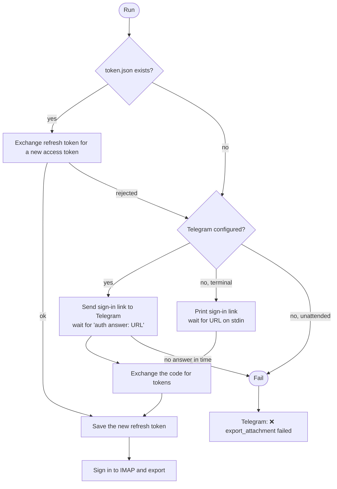

# Outlook attachment export

[bin/export_attachment.cs](./bin/export_attachment.cs) signs in to a **personal Outlook.com mailbox over IMAP**, finds the emails whose subject contains a given word within a date range, and saves every email attached to them as a PDF named after the outer email's subject.

It is built for this chain:

```text
Work mailbox ──(rule: forward as attachment)──▶ Personal Outlook.com ──(IMAP + OAuth2)──▶ export_attachment ──▶ Subject_Of_Email.pdf
```

Personal Outlook.com no longer accepts passwords or app passwords over IMAP, so the script signs in with a Microsoft account token (OAuth2). The token is cached and renewed on every run, and when it can't be renewed the script asks you to sign in again through Telegram, so it can run unattended.

## Prerequisites

| What | Why | Check |
|------|-----|-------|
| .NET SDK 11 | The script is a file-based C# app (`dotnet file.cs`) | `dotnet --version` shows `11.x` |
| [fnox](https://fnox.jdx.dev/) | Loads the secrets below as environment variables | `fnox exec -- env \| grep MAIL_` |
| Personal Outlook.com account | The mailbox the script reads | Sign in at outlook.com |
| A rule in the work mailbox that **forwards as attachment** to the personal mailbox | The script exports the *attached* email, not the forwarding email | A forwarded email shows the original as an attachment |
| An Azure app registration (free) | Microsoft only issues IMAP tokens to a registered app | See [Register the app in the Azure portal](#register-the-app-in-the-azure-portal) |
| A Telegram bot and your chat ID | Sends the sign-in request and failure alerts, and receives your answer | `TELEGRAM_BOT_TOKEN` and `TELEGRAM_CHAT_ID` already exist in [fnox.toml](./fnox.toml) |
| Network access to `login.microsoftonline.com`, `outlook.office365.com:993` and `api.telegram.org` | Sign-in, IMAP and Telegram | |

The Telegram bot must not have a webhook set, and no other program may read its updates (`getUpdates`) while the script waits for an answer. Sending messages from other scripts, as [post_clockify.sh](./bin/post_clockify.sh) does, is fine.

## Register the app in the Azure portal

You do this once. App registrations are free.

1. Sign in to <https://portal.azure.com> with any Microsoft account. If the portal says you have no directory, sign up for the free Azure account first; that creates one.
2. Open **Microsoft Entra ID → App registrations → New registration**.
   - **Name:** anything, e.g. `export-attachment`.
   - **Supported account types:** *Personal Microsoft accounts only*.
   - **Redirect URI:** leave empty for now.
   - Select **Register**.
3. On the app's **Overview** page, copy the **Application (client) ID**. This is `MAIL_CLIENT_ID`.
4. Open **Authentication → Add a platform → Mobile and desktop applications**, tick
   `https://login.microsoftonline.com/common/oauth2/nativeclient` and select **Configure**.
5. Still under **Authentication**, set **Allow public client flows** to **Yes** and select **Save**. The script has no client secret, so the app must be a public client.
6. Optional: open **API permissions → Add a permission → Microsoft Graph → Delegated permissions**, add `IMAP.AccessAsUser.All` and `offline_access`. The script requests these at sign-in anyway, and you consent to them on the first sign-in; adding them here only lists them up front.

You don't need a client secret or a certificate.

## Store the secrets

Add the two new secrets to fnox from the repository root. `fnox set` prompts for the value when it is omitted, which keeps it out of shell history.

```sh
cd ~/.secret
fnox set MAIL_USERNAME      # your personal address, e.g. someone@outlook.com
fnox set MAIL_CLIENT_ID     # the Application (client) ID from step 3
```

Neither is very sensitive, so `--provider plaintext` is fine if you prefer it readable in `fnox.toml`. `MAIL_PASSWORD` is not needed for Outlook.com.

All settings:

| Option | Environment variable | Default | Notes |
|--------|----------------------|---------|-------|
| `--mail-subject` | | (required) | Word or phrase the subject must contain |
| `--mail-from` | | today | First day, `yyyy-MM-dd` |
| `--mail-to` | | today | Last day, inclusive, `yyyy-MM-dd` |
| `--mail-username` | `MAIL_USERNAME` | (required) | Mailbox address |
| `--mail-client-id` | `MAIL_CLIENT_ID` | | Turns on Microsoft sign-in |
| `--mail-password` | `MAIL_PASSWORD` | | Only for IMAP servers that still accept passwords; ignored when a client ID is set |
| `--mail-host` | `MAIL_HOST` | `outlook.office365.com` | |
| `--mail-port` | `MAIL_PORT` | `993` | |
| `--mail-secure` | `MAIL_SECURE` | `true` | `true` = TLS on connect, `false` = STARTTLS |
| `--mail-folder` | `MAIL_FOLDER` | `INBOX` | Folder to search, e.g. `Archive` |
| `--auth-timeout` | | `720` | Minutes to wait for the Telegram sign-in answer |
| `-o`, `--output` | | current directory | Where the PDFs go |
| | `TELEGRAM_BOT_TOKEN`, `TELEGRAM_CHAT_ID` | | Sign-in requests and failure alerts |
| | `XDG_STATE_HOME` | `~/.local/state` | Parent folder of the token cache |

## Sign-in flow

The token cache is `~/.local/state/export_attachment/token.json`. The folder is readable only by you (mode `700`, file `600`). It holds the refresh token and when it was saved.



### Cached sign-in (every normal run)

1. The script reads the refresh token from `token.json`.
2. It exchanges it at Microsoft for an access token (valid for about an hour) and a **new** refresh token.
3. It saves the new refresh token, replacing the old one, and signs in to IMAP.

A refresh token lasts 90 days and every use starts a new 90 days, so a monthly schedule never lets it expire. Nothing is sent to Telegram.

### First sign-in, or when the cached one is no longer valid

This happens on the very first run, and later only if the token was revoked: you changed your Microsoft password, removed the app's access, Microsoft flagged a security event, or the script didn't run for more than 90 days.

1. The script sends a Telegram message with a sign-in link.
2. Open the link, sign in with the personal account, and on the first sign-in accept the permissions.
3. You land on a **blank page**. Copy the full URL from the address bar. It looks like
   `https://login.microsoftonline.com/common/oauth2/nativeclient?code=M.C5...&state=...`.
4. Reply to the bot: `auth answer: <the URL>`. Pasting only the `code` value works too.
5. The bot replies **👍 Got it, signing in.**, the script saves the new token and continues.

Send the answer within a few minutes of signing in: the code in that URL expires about 10 minutes after the redirect. The link itself doesn't expire while the script waits (12 hours by default). If the code expires, the run fails; run the script again to get a new link.

Sharing the URL in Telegram is safe: the code in it can only be exchanged together with a secret that stays inside the running script (PKCE).

To do the first sign-in in a terminal instead, run without the Telegram variables. The script prints the link and reads the URL from the terminal:

```sh
cd ~/.secret
fnox exec -- env -u TELEGRAM_BOT_TOKEN -u TELEGRAM_CHAT_ID \
  dotnet bin/export_attachment.cs --mail-subject Invoice
```

## Running it

```sh
cd ~/.secret
fnox exec -- ./bin/export_attachment.cs --mail-subject Invoice --mail-from 2026-10-01 --mail-to 2026-10-31 -o ~/Documents/invoices
```

The first run downloads the NuGet packages and builds; later runs reuse the cached build.

What it exports:

- An email attached as a message (`message/rfc822`, which is how Outlook forwards as attachment) or as an `.eml` file.
- The PDF has a header with From, To, Cc, Date and Subject of the attached email, followed by its HTML body (or plain text). Inline images are included.
- File name: the outer email's subject with whitespace and characters not allowed in file names replaced by `_`, e.g. `Monthly Invoice: October 2026` → `Monthly_Invoice__October_2026.pdf`. An existing file is never overwritten; the next one gets `_2`, `_3`, …
- Outlook `.msg` attachments are skipped with a message.

The date range uses the date the personal mailbox **received** the forward, not the date the original email was sent. The mailbox is opened read-only; nothing is moved, flagged or marked as read.

## Scheduling monthly

Follow the same pattern as the other [schedules](./schedules/): a wrapper script in `bin/` that loads fnox, and a systemd user service plus timer. For a run on the 1st that exports the previous month:

`bin/export_attachment.sh`

```sh
#!/usr/bin/env bash
set -euo pipefail
export PATH="$HOME/.local/share/mise/shims:$PATH"
cd "$HOME/.secret"

first_of_last_month=$(date -d "$(date +%Y-%m-01) -1 month" +%F)
last_of_last_month=$(date -d "$(date +%Y-%m-01) -1 day" +%F)

exec fnox exec -- dotnet bin/export_attachment.cs \
  --mail-subject Invoice \
  --mail-from "$first_of_last_month" \
  --mail-to "$last_of_last_month" \
  -o "$HOME/Documents/invoices"
```

`schedules/export_attachment.service`

```ini
[Unit]
Description=Export forwarded Outlook attachments as PDF

[Service]
Type=oneshot
ExecStart=%h/.secret/bin/export_attachment.sh
```

`schedules/export_attachment.timer`

```ini
[Unit]
Description=1st of every month, 08:00

[Timer]
OnCalendar=*-*-01 08:00
Persistent=true

[Install]
WantedBy=timers.target
```

`Type=oneshot` has no start timeout by default, so the service can wait the full `--auth-timeout` for a Telegram answer. If you add `TimeoutStartSec`, make it longer than that. `date -d` is GNU date (Linux); on macOS use `gdate` from coreutils.

Run `./bootstrap.sh` to install the units, then add a row to the schedule table in [README.md](./README.md).

## Troubleshooting

| Symptom | Cause and fix |
|---------|---------------|
| `AADSTS50011` (redirect URI mismatch) | The nativeclient redirect URI isn't on the app. Repeat step 4 of the app registration. |
| `AADSTS7000218` (client_assertion or client_secret required) | **Allow public client flows** is off. Repeat step 5. |
| `AADSTS700016` (application not found) | Wrong `MAIL_CLIENT_ID`, or the app doesn't allow personal accounts. |
| `invalid_grant` when exchanging the code | The code expired (answer within ~10 minutes of signing in) or was already used. Run again for a new link. |
| `Cached sign-in is no longer valid (invalid_grant)` | The refresh token was revoked or unused for 90 days. Answer the Telegram sign-in request. |
| `AUTHENTICATE failed` from IMAP | Signed in with a different account than `MAIL_USERNAME`, or IMAP is turned off in Outlook.com (Settings → Mail → Forwarding and IMAP). |
| Telegram `409 Conflict` | Another program reads the same bot's updates, or the bot has a webhook (`deleteWebhook` removes it). |
| No reply from the bot after sending the answer | The message must come from `TELEGRAM_CHAT_ID` and start with `auth answer:`. |
| `Found 0 email(s)` | Check `--mail-folder` (the forwarding rule may file them elsewhere) and that the dates match when the forward arrived. |
| `Skipped "...": no attached email` | The work rule forwards inline instead of as an attachment. |

To force a fresh sign-in, delete the cache:

```sh
rm ~/.local/state/export_attachment/token.json
```

To revoke the app's access entirely, remove it at <https://account.live.com/consent/Manage>, then delete the cache.
